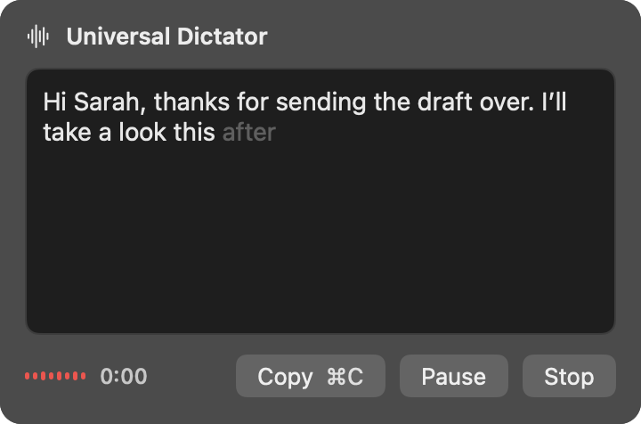

# Universal Dictator

Dictation into any app on your Mac. Double-tap Right Shift and talk: your words are typed at the cursor as you say them. Speech recognition runs on your Mac's Neural Engine, and your voice never leaves the computer.

https://github.com/user-attachments/assets/28cc3a3e-44f4-4e2c-8f1f-1d447ba27f49

Universal Dictator works wherever you can type: email, chat, documents, the browser, a code editor. Put the cursor in a text field, double-tap Right Shift, and talk. Each word appears at the cursor about 0.3 seconds after you say it, as if you'd typed it yourself. Tap Right Shift again to stop.

It lives in the menu bar, with no windows of its own. For when you'd rather see the text before it goes anywhere, clicking the menu bar icon opens a small panel to dictate into, edit and copy from.

It uses NVIDIA's [Nemotron Speech Streaming](https://huggingface.co/nvidia/nemotron-speech-streaming-en-0.6b) model, run entirely on your Mac. There's no account, no subscription and no internet connection involved, and it's free and open source.

## Features

- **Types into any app:** words go straight into the text field you're in, as you say them.
- **Live:** each word appears about 0.3 seconds after you say it.
- **Your shortcut:** a double tap of any modifier key, or a key combination; tap to start and stop, or hold to talk.
- **Private:** audio is processed on your Mac and never stored or sent anywhere.
- **History:** your last 50 dictations, searchable, kept on your Mac.
- **A panel too:** dictate into a small window instead, pause and fix words, then copy.
- **Fast or Accurate:** choose between quicker words and more context.

## Requirements

- A Mac with Apple silicon (M1 or later).
- macOS 15 Sequoia or later.
- About 1.2 GB of disk space.
- English: the model recognises English speech only.

## Installation

1. Download `UniversalDictator-<version>.dmg` from the [latest release](https://github.com/mdenil/universal-dictator/releases/latest).
2. Open the DMG and drag **Universal Dictator** onto **Applications**.
3. Open Universal Dictator from your Applications folder. **macOS refuses the first time,** because the app isn't notarized by Apple (that needs a paid Apple developer account). To open it anyway:
   1. Open **System Settings › Privacy & Security**.
   2. Scroll down to the message about Universal Dictator and click **Open Anyway**.
   3. Confirm, and enter your password if asked.
4. Allow the **microphone** when the app asks.
5. Allow **Accessibility** when the app asks: in System Settings, switch on Universal Dictator. This is what lets it type into other apps.

The app has no Dock icon: look for the waveform icon in the menu bar, next to the clock.

The first time it starts, the app spends about 20 seconds preparing the speech model. If you use the shortcut meanwhile, the panel opens with "Getting things ready for you…" and starts listening by itself when it's ready. After that, the app starts in under a second.

**To start it when you log in,** add it in System Settings › General › Login Items.

## Usage

### Typing into any app

Put the cursor in a text field in any app and **double-tap Right Shift**. A short sound plays and the menu bar icon's bars start moving when the microphone is live. Each word is then typed at the cursor as it's recognised.

- **Toggle** (the default): tap Right Shift once to stop.
- **Push to talk** (in Settings): double-tap Right Shift and keep holding it while you talk; release it to stop.

Stopping types the last word and a space. Clicking the menu bar icon also stops it.

Nothing is ever typed into password fields, or into apps using secure keyboard entry (such as Terminal with that option turned on).

### The panel

Click the menu bar icon: a panel opens under it and listening starts. The text appears as you speak; the grey word at the end is still being recognised.

The quickest use: click, talk, press **⌘C**, then **⌘V** wherever you want the text.

| Key | Button | What it does |
|---|---|---|
| ⌘C | Copy | Stops, copies all the text and closes the panel. |
| Space | Pause | Pauses: the icon turns yellow and the text becomes editable. **Resume** keeps your edits and adds new words after them. |
| Return | Stop | Ends the dictation. The text stays editable. |
| ⌘Return | Copy | After stopping: copies the text and closes the panel, returning you to the app you were in, ready for ⌘V. |
| | New | After stopping: starts a new dictation. |

Closing the panel (clicking elsewhere, or on the icon) ends the dictation, and the next click starts a new one. The exception is a paused dictation: it survives closing the panel, and the next click reopens it, still paused.

### History

Every dictation, typed or in the panel, goes into History. Right-click the menu bar icon to see the five latest; choosing one copies it. **Show All History…** opens a window where you can search all of them, and copy, edit or delete each one.

History keeps your last 50 dictations; Settings can change that to anywhere from 10 to 200.

### Settings

Right-click the menu bar icon and choose **Settings…**, or press **⌘,** while the panel is open.

| Setting | Choices |
|---|---|
| Shortcut | **Double tap** of a modifier key (Left or Right ⇧ ⌃ ⌥ ⌘), or a **Key combination** such as ⌃A or ⌘⇧D. Combinations that would get in the way of normal typing or standard commands show a warning. |
| Mode | **Toggle** or **Push to talk**. |
| Accessibility | Whether typing into other apps is allowed, with a button to allow it. |
| Model | **Fast** (the default) shows words sooner. **Accurate** listens in longer pieces (560 ms rather than 160 ms), so words appear a little later and the model has more context to get them right. Switching takes under a second, except the first time each one is used, when it's prepared like at the first launch. |
| History | How many dictations to keep, and **Clear History…** |

## Updating

Download the new DMG from the [Releases page](https://github.com/mdenil/universal-dictator/releases) and drag the app onto Applications again, replacing the old one. Your history and settings are kept.

Because the app isn't notarized, macOS treats each version as a new app:
- **Open Anyway** is needed again, as when you first installed it.
- macOS may ask for the **microphone** again.
- **Accessibility** has to be allowed again; see [Troubleshooting](#troubleshooting).
- The speech model is prepared again at the first launch (about 20 seconds).

## Privacy

- Speech recognition runs on your Mac. The app contains no networking code; audio isn't recorded to disk or sent anywhere.
- History is a file on your Mac: `~/Library/Application Support/dev.universaldictator.UniversalDictator/history.json`. **Clear History…** in Settings deletes it all; History's Delete button removes one dictation.

## Troubleshooting

**"Universal Dictator can't be opened" or "Apple could not verify…"**
The app isn't notarized. Use **Open Anyway** in System Settings › Privacy & Security, as in [Installation](#installation).

**The shortcut opens the panel saying "Typing in other apps is off"**
Accessibility isn't allowed. Click **Open System Settings** and switch on Universal Dictator under Accessibility. If it's already listed and switched on, the entry is from an earlier version: select it, remove it with **−**, then add the app back with **+** and switch it on.

**The shortcut only flashes a warning triangle on the menu bar icon**
Some app has secure keyboard entry turned on, which stops any app from typing: a password field has the focus, or an app such as Terminal has Secure Keyboard Entry switched on in its menu. Move to an ordinary text field, or turn that option off.

**Nothing appears when I talk**
Check that Universal Dictator is allowed in System Settings › Privacy & Security › Microphone, and that the right microphone is selected in System Settings › Sound › Input.

**The panel says "Getting things ready for you…" for a while**
The speech model is being prepared, which takes about 20 seconds the first time after installing or updating, and the first time you choose the other model. Dictation starts by itself when it's done.

## Uninstalling

Quit the app (right-click the icon › Quit) and move it from Applications to the Trash. To remove its history and settings too, delete:

- `~/Library/Application Support/dev.universaldictator.UniversalDictator`
- `~/Library/Caches/dev.universaldictator.UniversalDictator`
- `~/Library/Preferences/dev.universaldictator.UniversalDictator.plist`

and remove it from the Microphone and Accessibility lists in System Settings › Privacy & Security.

## Building from source

The app can be built from this repository with Xcode, and the repository also has `dictate-cli`, the command-line tool its speech engine was developed with, which runs two more speech models. Both are covered in [docs/DEVELOPMENT.md](docs/DEVELOPMENT.md).

## Acknowledgments

Speech recognition is NVIDIA's [Nemotron Speech Streaming English 0.6B](https://huggingface.co/nvidia/nemotron-speech-streaming-en-0.6b) model.

## License

Universal Dictator is licensed under the Apache License 2.0; see [`LICENSE`](LICENSE) and [`NOTICE`](NOTICE).

The app contains the Nemotron model, which is licensed by NVIDIA Corporation under the [NVIDIA Open Model License](docs/licenses/NVIDIA-Open-Model-License.txt). A copy of the app you pass on to someone else is covered by that license too. The license texts are in the DMG's Licenses folder and inside the app.
